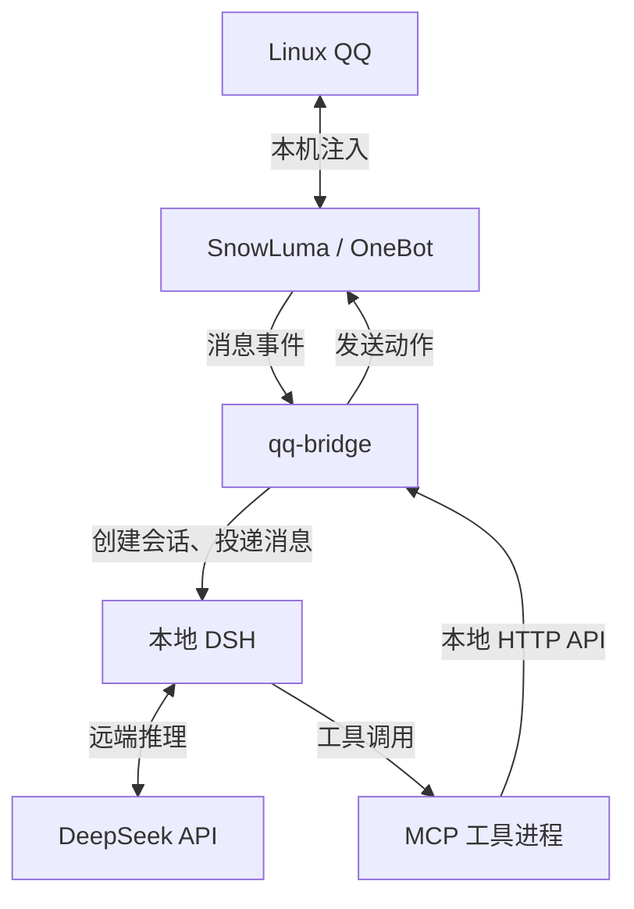

# DS_bot

基于 **Linux QQ + SnowLuma + qq-bridge + DeepSeek Harness（DSH）** 的个人 QQ 智能体项目。
通过本机 QQ 接收私聊和群消息，由 DSH 调用远端 DeepSeek 模型，再通过受限 MCP 工具回复。

> **AI 生成说明：本 README、公开部署说明、发布整理及部分集成修改由 AI 辅助生成。**
> `qq-bridge/` 主要来自第三方开源项目，保留原作者版权与许可证，不能视为 AI 或本仓库作者独立创作。
> 本仓库是去除本机信息、账号配置和运行状态后的源码发布版，不包含正在使用的机器人账号数据。

## 第三方项目

| 项目 | GitHub 地址 | 在本项目中的作用 |
| --- | --- | --- |
| qq-bridge | [Derpyu520/qq-bridge](https://github.com/Derpyu520/qq-bridge) | QQ 与 DSH 的业务桥接、控制台和聊天工具 |
| DeepSeek Harness | [deepseek-ai/deepseek-harness](https://github.com/deepseek-ai/deepseek-harness) | 智能体运行时、模型调用和会话管理 |
| SnowLuma | [SnowLuma/SnowLuma](https://github.com/SnowLuma/SnowLuma) | 将本机 QQ 接入 OneBot 协议 |
| Node.js | [nodejs/node](https://github.com/nodejs/node) | JavaScript 运行环境 |
| MCP TypeScript SDK | [modelcontextprotocol/typescript-sdk](https://github.com/modelcontextprotocol/typescript-sdk) | MCP 工具服务 |
| js-yaml | [nodeca/js-yaml](https://github.com/nodeca/js-yaml) | YAML 解析 |
| Zod | [colinhacks/zod](https://github.com/colinhacks/zod) | 数据与参数校验 |
| DeepSeek Schemastery | [deepseek-harness/vendor/schemastery](https://github.com/deepseek-ai/deepseek-harness/tree/master/vendor/schemastery) | DSH 插件设置定义 |

桥接源码基于 `qq-bridge v0.2.1-r1`。具体来源、修改范围及许可边界见 [THIRD_PARTY.md](THIRD_PARTY.md)。
SnowLuma 是独立外部依赖，不随本仓库分发；不能把整套外部依赖都视为 MIT 开源软件。

## 当前部署环境

以下是整理仓库时（2026-10-26）的实际部署基线，只公开软件环境，不包含机器名称、
登录用户名、私人路径、账号、群号、令牌或 API 密钥。

| 项目 | 环境 |
| --- | --- |
| 操作系统 | Ubuntu 24.04.4 LTS，x86_64，桌面登录会话 |
| Node.js / npm | 24.22.1 / 11.19.1；桥接要求 Node.js ≥ 22.13.0 |
| Python | 系统 Python 3.12.3，仅运维备份脚本需要 |
| QQ 接入 | Linux QQ 桌面客户端，本机登录，SnowLuma 手动加载进程 |
| SnowLuma | v1.14.20，本机原生运行 |
| DSH | 0.2.1-rc.2 |
| qq-bridge | v0.2.1-r1，并保留 Unicode 输入处理修改 |
| 模型 | `deepseek-official` / `deepseek-flash`，远端 API 推理 |
| 服务管理 | 用户级 systemd；依赖用户登录会话 |
| 已使用能力 | 二代模式、文字／引用／图片、角色、主动发言、表情包与 AI 收藏 |

公开示例采用空白名单、空凭据和关闭主动发言的默认配置，不复制实际部署的功能开关及账号。
这些版本是已部署记录，不表示必须使用的最新版本；升级 DSH 时需检查桥接协议和工具兼容性。

## 技术栈与架构

- JavaScript ES Modules、Node.js 内置 HTTP 服务：桥接业务、控制台 API 和调度。
- OneBot v11 HTTP / WebSocket：QQ 消息事件与动作接口。
- DSH Web API、会话事件流：模型会话、回合状态和 token 用量。
- MCP stdio 工具：读取未读消息、发送回复、处理图片与表情等。
- 原生 HTML / CSS / JavaScript：浏览器控制台，无独立前端框架构建步骤。
- JSON / JSONL：配置、会话映射和运行状态；Python 标准库与 systemd：本机运维。



每个群或私聊映射到一个独立 DSH 会话。桥接负责白名单、消息队列、唤醒、限频和出站校验；
DSH 负责模型上下文及工具执行。在二代模式 `reserved2` 下，模型普通文本不会自动转发到 QQ，
需要调用 `qq_send_message` 等工具才能发言。主动发言由桥接的定时检查触发模型处理。

所有管理入口默认使用回环地址：SnowLuma 面板 `127.0.0.1:5099`、OneBot HTTP `:3000` /
WebSocket `:3001`、DSH `:3080`、桥接控制台 `:3100`。端口和鉴权均需使用者自行配置。

## 项目结构

```text
DS_bot/
├── README.md                    # 项目介绍与部署基线（AI 辅助生成）
├── LICENSE                      # 新增集成代码与文档的 MIT 许可
├── THIRD_PARTY.md                # 第三方来源、版本与许可说明
├── .gitignore                   # 排除凭据、账号、状态、备份和本机文件
├── scripts/
│   └── check-publication.py      # 对 Git 暂存内容做发布检查
├── qq-bridge/
│   ├── src/                     # 桥接主程序、DSH 客户端、MCP 与媒体工具
│   ├── public/console.html      # 桥接管理界面
│   ├── dsh/agent-presets/       # 普通聊天与二代聊天的预设源文件
│   ├── plugins/                 # DSH 插件、生成的预设及工具权限限制
│   ├── roles/                   # 仅发布通用示例；个人角色卡保持本地
│   ├── scripts/                 # 安装、检查和测试脚本
│   ├── docs/                    # 上游使用与兼容说明
│   ├── config.example.json      # 无账号和密钥的配置模板
│   └── package.json             # npm 依赖与命令
├── ops/
│   ├── README.md                # 公开运维模板使用说明
│   ├── status.mjs               # 只读连接状态检查
│   ├── maintenance.py           # 私有配置备份工具
│   └── systemd/*.example        # 可调整的用户服务模板
└── snowluma/README.md           # 外部网关手动配置说明，不含程序本体
```

`qq-bridge/src/bridge.js` 目前仍是主要业务中枢；`src/core/session-router.mjs` 是已有但尚未接入
主入口的路由模块。完整模型会话保存在 DSH 自身的数据目录中，不在公开仓库内。

## 基本使用

1. 安装对应版本的 Node.js、Linux QQ，并按 [DSH 官方项目](https://github.com/deepseek-ai/deepseek-harness)
   的说明安装、配置模型凭据。SnowLuma 由使用者按 [官方项目](https://github.com/SnowLuma/SnowLuma)
   的说明独立取得并启动，详见 [网关说明](snowluma/README.md)。
2. 克隆仓库并安装桥接依赖：

   ```bash
   git clone https://github.com/hiGhbYte29/DS_bot.git
   cd DS_bot/qq-bridge
   npm ci
   cp config.example.json config.json
   ```

3. 编辑本地 `config.json`：填写自己的 OneBot 地址与令牌、管理员和白名单。
   保持 `allowAllWhenEmpty=false`；空白名单时机器人不会响应任何会话。
   模型 API 密钥交给 DSH 管理，勿写入公开示例。
4. 在 `qq-bridge/` 目录运行 `node scripts/setup-dsh.mjs` 注册预设与 MCP，然后启动或重启 DSH。
   终端运行方式为 `dsh web`。该步骤会修改本机 DSH 配置。
5. 登录本机 QQ，在 SnowLuma 进程页面手动“加载”，确认 OneBot 接口已开启。
6. 在另一个终端进入 `qq-bridge/` 执行 `npm start`。通过桥接控制台配置角色和需要的功能。

启动后可在仓库根目录执行 `node ops/status.mjs` 检查连接层状态；这不代替真实消息收发验收。
需要常驻运行时参考 [ops/README.md](ops/README.md)。公开 systemd 模板只管理 DSH 和桥接，
SnowLuma 的安装、启动和 QQ 登录由使用者独立完成。不要同时运行 systemd 服务与第二份手动桥接进程。

## 扩展入口

| 目标 | 入口 |
| --- | --- |
| 人设与语气 | 本地 `roles/*.md`，可复制 `generic.example.md` 后编辑 |
| 二代行为协议 | `dsh/agent-presets/qq-chat-v2/`；修改后重新生成、注册预设 |
| 新 QQ 动作 | `src/mcp-snowluma-safe.js` 的工具定义与桥接执行接口 |
| 唤醒与主动发言 | `src/bridge.js` 中的二代调度逻辑 |
| 外部工具 | 独立 MCP 服务，同时检查 QQ 预设的工具允许范围 |

角色及部分控制台配置可热更新；MCP 工具清单和预设更新通常需要重启 DSH。
管理控制台修改与直接编辑文件的生效方式不同，具体以对应模块实现为准。

## 发布与隐私

`.gitignore` 排除真实配置、DSH 凭据、OneBot 账号文件、登录数据、聊天状态、工具日志、备份、
私人图片和语音、当前角色卡、本机服务定义，以及全部依赖安装目录。
只提交源码、通用示例和去标识的文档；首次公开提交不带原部署目录或上游 Git 历史。

提交前运行：

```bash
git add README.md .gitignore   # 按需明确选择本次修改的文件
python3 scripts/check-publication.py
git diff --cached --stat
```

检查工具读取 Git 暂存内容，拦截常见敏感文件和密钥形式；不能保证识别所有私人内容。
不要用 `git add -f` 强制加入被忽略的配置。`.gitignore` 不会自动移除已跟踪文件或历史中的内容。
运行时 QQ 消息会经 DSH 发送给模型服务方；配置备份也可能含密钥，应仅保存在本地私有目录。

## 分支与许可

- `main`：公开主分支。
- `DS_botdev`：开发分支，名称为项目名 `DS_bot` 加 `dev`。

新增代码和文档使用 [MIT](LICENSE)；桥接源码保留 [上游 MIT 声明](qq-bridge/LICENSE)。
其他依赖适用各自许可，详见 [THIRD_PARTY.md](THIRD_PARTY.md)。
