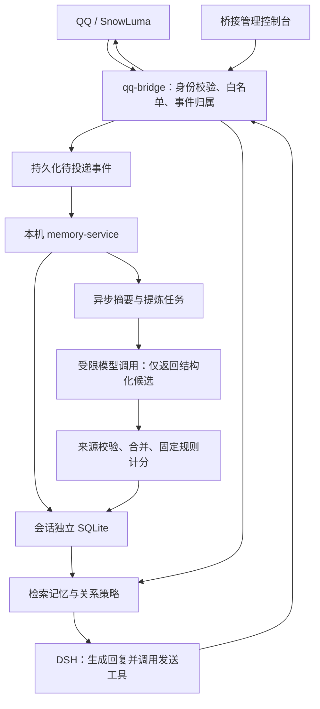

# 第一版：会话独立的长短期记忆与好感度系统

> 状态：设计方案，尚未实现或启用。版本：V1 草案，2026-10-27。
>
> 本文由 AI 根据项目源码与需求讨论整理。示例均使用虚构标识，不包含部署路径、真实账号、群号或凭据。
> 文中保留时间、计分、预算和阈值是可调初始值，尚未经实际聊天验证。
>
> 相关文档：[项目说明](../README.md) · [扩展开发指南](how-to-extend.md) · [已知问题](known-issues.md)

## 1. 目标与首版范围

在现有 `Linux QQ → SnowLuma → qq-bridge → DSH` 链路旁增加一个本机记忆服务，做到：

1. 同一会话跨回合、跨服务重启保留有用信息；不同群、不同私聊相互隔离。
2. 短期记忆维持当前话题，长期记忆保存有来源的事实、偏好和共同经历。
3. 每个会话中的每个成员拥有独立的偏好、好感度、熟悉度和短期交流氛围。
4. 关系状态影响回复表达；计分过程可查看、纠正、撤销和重算。
5. 服务故障时普通聊天可降级继续；删除和纠错具有完整的失效机制。

| V1 实现 | 后续再做 |
| --- | --- |
| bridge 自动采集、检索和注入，管理端维护 | 模型主动调用的新记忆工具 |
| 单个本机服务，每个会话一个 SQLite 数据库 | 多机部署、跨会话共享、分布式队列 |
| 结构化筛选、关键词检索、滚动摘要 | 向量检索、复杂知识图谱、模型微调 |
| 有来源的长期条目和偏好 | 自动画像、缺少依据的深层人格推断 |
| 事件计分、解释记录、关系风格 | 复杂恋爱数值、公开排行榜、多角色关系网络 |
| 正向事件自动计分，负向长期计分人工确认 | 无人审核的自动长期负面评价 |
| 调整回复风格与话题候选 | 根据好感提高主动发言频率或改变唤醒概率 |

公开配置默认关闭新功能。先在虚构数据及单个测试会话中验证，再逐个启用。

## 2. 现有能力与设计边界

目前二代模式在 `social-v2.json` 中保存 `activeTopics`、`pendingThoughts`、`memberImpressions` 等轻量状态。
人物印象以名字或昵称为键；`interactionCount` 在追加印象时递增，不能作为真实互动次数或好感基础。
实现见 [bridge.js](../qq-bridge/src/bridge.js) 的 `appendMemoryV2`、`formatMemoryV2`。

DSH 另外维护模型会话及压缩后的上下文。它承担推理上下文管理，外挂承担可查询、可维护的业务记忆。
DSH 会话编号只用于运行时映射，不能作为长期记忆的永久身份。

V1 由 bridge 提供可信的消息、身份和会话范围，记忆服务计算并返回上下文；DSH 根据这些资料生成回复。
SnowLuma 接入方式、QQ 手动加载方式和现有发送授权机制保持现有职责。

## 3. 架构与处理流程



**入站：**消息通过已有鉴权、白名单及功能开关后，由 bridge 形成可信事件并持久化投递。
群内只有启用记忆的会话参与采集；是否唤醒回复仍由现有调度决定。消息被采集不等于已经回复。

**出站：**只把确认发送成功的机器人消息记录为对话事件，未发送草稿和内部推理不入库。
机器人输出可用于理解上下文，不能单独证明用户偏好或触发好感加分。

**回复前：**按当前会话、对象和问题检索短期上下文、相关长期条目及关系策略，生成一次有预算的快照。

**回复后：**异步合并一个互动片段，提炼摘要、偏好及关系事件。复用一次结构化提炼结果，避免每条消息分别调用多个模型。
提炼模型只返回候选数据，不获得发送消息、任意读库或修改分数的工具权限。

明确的当前要求，例如“这次请简短回答”，当轮直接遵守。长期保存成功前不声称“已经记住”；
存在歧义时先保留为候选，不把单次情绪或请求自动推广成长期偏好。

## 4. 会话与成员隔离

```text
scope = (deploymentId, platform, verifiedBotAccountId, conversationKind, conversationId)
relationshipKey = (scope, userId)
```

- `platform` 在 V1 固定为 `qq`；`conversationKind` 区分 `private` 和 `group`。
- 使用稳定用户 ID，昵称仅用于展示；示例标识使用 `user_A`、`group_X` 等虚构值。
- 同一人在群 X、群 Y 和私聊中的记忆及关系分别保存，默认不共享。
- scope 由 bridge 从可信网关事件中生成，模型文本、工具参数或昵称不能选择数据库和读取范围。
- 数据目录使用内部生成的不透明 scope ID；查询、缓存、任务、去重键和审计都包含 scope。
- V1 每套 bridge 数据目录绑定一个 bot 账号。启动、重连及接收事件时校验身份；身份不匹配时暂停处理，禁止复用旧 DSH 会话。
- 角色文案调整不更换关系主键。独立多角色关系留待后续使用稳定 `personaId` 扩展。

每个 scope 独立数据库有利于审计、导出和删除，但进程仍须逐次校验范围；数据库分文件不能代替权限检查。
服务优先通过限制文件权限的 Unix socket 与 bridge 通信，不直接向 QQ 用户或模型暴露通用查询入口。

## 5. 短期记忆、长期记忆与检索

### 5.1 短期记忆

| 内容 | 建议初始规则 |
| --- | --- |
| 原始消息事件 | 保留 7 天；限制单条长度及每个 scope 的存储量 |
| 最近对话窗口 | 每次最多取 20～40 条，并服从总 token 预算 |
| 滚动摘要 | 累计约 30 条新消息或空闲约 10 分钟后生成一次 |
| 当前话题、未完成事项 | 保存来源、更新时间和过期时间，完成后关闭 |
| 短期交流氛围 | 默认约 60 分钟后回归中性；不自动写成人格标签 |

摘要记录覆盖的消息范围与来源，更新时只处理新增部分。通过水位、任务去重和最短间隔避免空闲期间反复提炼同一段对话。
图片首版只复用已有识别结果中的必要描述，标明推测和来源；不新增图片归档或后台批量识别。

### 5.2 长期记忆

保存四类条目：明确告知的事实、用户偏好、值得保留的共同经历、仍有效的长期事项。
每条记录至少包含：归属对象、内容、来源、明确告知或推测、状态、创建和确认时间、有效期。

状态采用 `candidate → active → superseded / revoked`：

- 明确且无歧义的自述可进入有效状态；模型推测先进入候选，不能当成已知事实注入。
- 冲突内容保留来源，区分“以前如此”和“现在改变了”，不能无解释覆盖。
- 当事人的明确偏好优先于第三方转述；引用内容不能自动归给引用者。
- 不提炼密钥、口令或登录凭据；普通日志只记录数量、耗时与错误类别。

原始消息到期后，支撑有效长期记忆或关系事件的最小必要证据可继续保留，必须在管理界面说明。
因此“原始消息保留 7 天”不表示所有派生资料都会在 7 天后消失。明确删除需要按第 9 节处理。

### 5.3 检索与注入

先限定 scope，再按当前对象、条目状态、有效期和关键词筛选；结合相关性、明确程度、重要性及时间排序。
可使用 SQLite FTS5；中文使用 trigram 时，短于三个字符的查询走结构化条件或有界子串匹配，不能只依赖全文索引。

初始取长期条目 5～8 条，最近消息、摘要、长期条目和关系策略共用约 3,000～4,000 token 的预算，
并随模型剩余上下文收缩。超预算时保留当前请求、明确偏好与必要上下文，剔除低相关内容。
资料注明来源和时间，作为不可信历史数据注入，不能变成覆盖系统规则的指令。

## 6. 偏好与好感度规则

### 6.1 四类状态

| 状态 | 定义 | 对回复的作用 |
| --- | --- | --- |
| 偏好 `preferences` | 话题、篇幅、称呼、表情、玩笑接受度等 | 决定说什么、如何表达；明确要求无需好感门槛 |
| 好感 `affinity` | 初始 50，范围 0～100 | 调整亲切程度与互动热情 |
| 熟悉度 `familiarity` | 有效互动片段数、活跃天数、共同经历 | 调整背景解释及回顾共同经历的方式 |
| 氛围 `mood` | 当前轻松、认真、低落或有摩擦 | 调整当前节奏，短期过期 |

角色可配置稳定的兴趣，如 Linux、编程、游戏。用户与角色有共同兴趣并实际开展有内容的讨论时，
可小幅加分；兴趣不同不默认扣分，未知也不等于不喜欢。角色兴趣配置由管理端维护，聊天文本不能直接改计分规则。

### 6.2 模型提事件，程序算分

模型返回事件类别、候选参与者、来源消息 ID、简短解释及歧义标记。
程序从可信消息重新校验作者、对象和引用关系，再按版本化规则计算分数；不接受模型给出的任意 `delta` 或最终分值。
模型置信度只是辅助，不能代替证据。

| 事件 | V1 好感变化 | 其他处理 |
| --- | ---: | --- |
| 正常完成一次面向 bot 的双向交流 | 0 | 增加熟悉度，每天最多计 2 个有效片段 |
| 围绕共同兴趣完成有效讨论 | +0.5 | 同一兴趣每周最多一次 |
| 明确表达具体交流愉快、感谢具体帮助或合作完成事项 | +1 | 同类每天最多一次，保留依据 |
| 要求换话题、改称呼、少用表情 | 0 | 更新偏好 |
| 正常纠错、反驳、拒绝、结束聊天、不回复 | 0 | 按需调整交流方式 |
| 明确且持续的针对性辱骂 | 人工确认后 −1 | 自动化先调整短期氛围；引用、反讽有歧义时不计分 |
| 刷屏、重复夸奖、直接索要加分、第三方转述 | 0 | 不产生重复奖励 |

```text
实际变化 = 按事件规则取值 → 同片段合并 → 同类冷却 → 每日额度限制
新好感 = clamp(旧好感 + 实际变化, 0, 100)
```

- 每人每个 scope 的每日正向、负向变化分别最多 3 分，两种额度独立计算，不能通过加减抵消后继续刷分。
- 一段互动只给一次主要奖励，不能叠加“感谢＋合作＋共同兴趣”；每日边界使用固定配置时区。
- 互动片段以已确认消息组成，由 bridge/service 生成稳定标识。重复接收、服务重启、重新摘要不能产生新奖励。
- 群成员之间的普通聊天不自动算作与 bot 的关系进展；需有直接互动依据。
- 久未聊天只改变近期活跃状态，不自动扣好感。单次摩擦不永久沉淀成负面人物印象。
- 规则版本和实际应用分值入账；升级默认仅作用于新事件，历史重算必须作为显式管理操作。

### 6.3 转换成回复策略

优先级为：权限及范围约束 → 本轮明确要求 → 已保存偏好 → 当前交流氛围 → 关系风格 → 默认角色设定。
模型主要接收派生策略，原始分数留给管理界面，避免主动向聊天对象播报数值。

```text
对象：由系统绑定的当前回复对象
关系：熟悉、友好
偏好：简短；少用表情；不使用亲昵称呼
共同兴趣：Linux、编程
当前氛围：轻松
策略：自然直接，可以温和接梗；只引用有证据的共同经历
```

可从初识、熟悉、熟悉且友好三种风格开始；熟悉需同时满足多日互动和有效片段数量，友好再结合好感。
具体门槛在测试集上校准，并设置进入/退出缓冲区，避免分数在边界附近让语气来回切换。
外号、亲昵称呼和玩笑仍以对方接受为前提。

同一句“代码终于跑通了”，初识时可以问“之前卡在哪一步？”，熟悉时可以提到已记住的依赖问题。
没有对应记忆时不能编造共同经历。高低好感不改变事实准确性、基本礼貌、正常问题的处理、工具权限或白名单。

群里回复某人时使用该人的状态；多人发言分别绑定对象，面向全群时使用公共语气。
V1 不根据好感提高主动发言频率，继续使用现有开关、白名单和限频规则。

## 7. 数据模型与模块划分

服务根目录保存私有 scope 注册信息；每个 scope 使用独立 SQLite 数据库。下表为逻辑模型，不是最终 SQL DDL。

| 表 | 核心内容 |
| --- | --- |
| `scope_meta` | schema 版本、普通状态 revision、强制失效 generation、绑定身份 |
| `messages` | 平台消息 ID、作者、方向、时间、正文、引用、发送确认及出站快照 ID |
| `evidence` | 最小证据片段、原消息 ID、作者、来源类别、有效状态 |
| `context_snapshots` | 回合、generation、已投递来源集合及成功出站消息关联 |
| `summaries` | 覆盖水位、摘要、来源关联、有效状态 |
| `memories` | 类型、对象、内容、候选/有效/替代/撤销状态、有效期 |
| `memory_sources` | 记忆或摘要与证据的关联，用于纠错和删除传播 |
| `user_preferences` | 用户 ID、偏好键值、明确/推测、适用范围、来源 |
| `relationship_events` | 用户、片段 ID、事件类别、证据、实际分值、规则版本、有效状态 |
| `relationship_profiles` | 可重算的好感、熟悉度、短期氛围及策略缓存 |
| `jobs` | 摘要/提炼任务、水位、租约、重试次数、generation |
| `deletions` | 最小删除标记及必要的不再记忆规则，不保留被删正文 |

V1 使用 Node.js、JavaScript ES Modules 与 SQLite，具体驱动在实施时按现有 Node 版本验证。
单进程承担每个数据库的写入，使用事务和唯一约束保证幂等；模型网络调用在事务外进行。
WAL 模式下使用 SQLite 支持的备份方式，不能只复制正在写入的主数据库文件。

建议新增的目录如下，当前尚不存在：

```text
memory-service/
├── src/
│   ├── server.js               # 受限本机接口
│   ├── scope-registry.js       # 身份绑定、scope 与数据库映射
│   ├── storage/                # SQLite、迁移、事务和删除传播
│   ├── ingest/                 # 消息校验、去重、互动片段
│   ├── retrieval/              # 结构化/关键词检索、预算
│   ├── consolidation/         # 摘要、长期提炼、任务队列
│   └── relationships/         # 事件校验、计分和回复策略
├── tests/                     # 虚构数据与契约测试
└── config.example.json        # 空凭据和保守默认值
qq-bridge/src/memory-client.js # 统一 adapter，隔离 bridge 与服务实现
```

数据库、注册表、缓存、队列、日志和备份放进已忽略的 `state/`、`runtime/` 或 `backups/` 目录。
不把实际成员信息、角色私有配置和聊天样本提交到公开仓库；发布前检查忽略规则及暂存内容。

## 8. bridge、DSH 与旧记忆的接入

### 8.1 首版调用边界

V1 自动采集和读取由 bridge 完成，管理操作经现有控制台鉴权进入 bridge。
内部能力包括 `ingest`、`prepareContext`、`list/update/revokeMemory`、`resetChat`、`forget` 和 `getRelationship`。
这些是拟议能力名，尚不是已实现的 API；目标 scope 由可信调用上下文绑定。

当前共享 MCP 通道不能天然提供可信的调用会话身份，不能用“最近活跃会话”、全局变量或模型自报的 sessionId 代替。
因此 V1 不新增模型可调用的通用记忆接口。将来若开放工具，应由 DSH 宿主适配器取得可信 sessionId，
经 bridge 映射到 scope，另做鉴权和串会话测试。

现有 `qq_get_prompt` 仍是模型可调用入口：V1 必须由 bridge 根据会话令牌反查唯一绑定范围，
请求中的 key 只用于一致性校验，并继续检查白名单；不能用控制台凭据或缺失令牌兜底。
这是令牌授权边界，不能宣称能防止另一会话令牌泄露后的冒用；令牌不得进入记忆正文或日志。

### 8.2 源码接入点

| 位置 | 拟议改动 |
| --- | --- |
| bridge 入站、发送成功回调 | 产生可信事件，经持久化待投递队列送入服务 |
| `deliverPromptNow` / `buildWakePromptV2` | 在异步投递阶段准备快照，再把已取得的上下文交给提示词构建函数 |
| `qq_get_prompt` 对应路由 | 使用同一 adapter 和预算策略，避免另取旧记忆或重复堆叠注入 |
| `appendMemoryV2` / `formatMemoryV2` / 旧管理路由 | 按 backend 分支处理，external 模式阻断旧记忆的读写和注入 |
| MCP 工具注册与二代 preset | external 模式停用旧 `qq_memory_*`，删除要求模型维护旧笔记的提示 |
| 桥接控制台 | 增加记忆、偏好、关系变化解释、纠错、遗忘及启停入口 |

模式建议为 `builtin` 和 `external`，作为待新增配置，不是当前已有开关。
external 模式以新服务为唯一记忆来源，但仍保留 `social-v2` 的未读水位、唤醒、发送限频等运行状态。
关闭工具注册之外，还必须在旧服务端 API 拒绝访问，防止已有 DSH 会话继续调用旧工具。
工具面与 preset 变化需重新生成/注册、重启相关进程，并重建测试会话；仅改文件不能视为已生效。

### 8.3 迁移与回退

默认不自动导入旧人物印象。管理端核实身份和来源后，可将旧话题、事项及印象作为候选导入，记录迁移版本和数量。
不按昵称猜测 userId，不将旧 `interactionCount` 转成好感或熟悉度；无来源条目不参与计分。

切换前保存本地备份并暂停目标会话。验证新链路后再启用 external；服务短时故障时不自动切回旧笔记。
显式回退也要重建相关 DSH 上下文，处理旧快照及删除记录，不能把已经遗忘的旧笔记重新启用。

## 9. 重置、遗忘与一致性

| 操作 | 语义 |
| --- | --- |
| `reset_chat` | 清活动窗口、滚动摘要、待处理想法并新建 DSH 会话；保留长期记忆和关系 |
| 删除指定记忆 | 撤销该条目及对应来源的适用关联，更新相关派生状态 |
| 删除指定证据 | 撤销依赖该证据的条目或转为待重新核实，重算相关关系 |
| 清除某人资料 | 在当前 scope 清除该人的偏好及关系，回到默认状态 |
| 不再记某事项/某人 | 在删除之外增加持续排除规则，后续采集和提炼遵守该规则 |

重置设置新的活动起点，旧消息不再进入短期窗口，也不由重置前任务重新生成已清摘要。
明确删除与普通保留期清理分开：消息到期不自动删除仍有效的最小长期证据。
兼容旧功能时不能把原本只清轻量笔记的命令悄悄扩大成删除整个记忆库。

**普通 revision 与强制失效 generation 分开：**普通加分或新增记忆用于下一次快照，不中断正在回复的回合。
删除、撤销及明确边界纠正才递增 generation，使旧任务和旧输出失效。

强制失效操作按以下步骤执行：

1. bridge 持久化失效操作 ID 和“处理中”状态，暂停该 scope 新回合和出站发送，终止旧在途回合。
2. 服务事务内记录删除/修正、递增 generation，撤销来源关联，重算好感和熟悉度，失效摘要、索引、缓存及相关任务。
3. bridge 清理旧待投递事件和上下文缓存；所有旧 generation 的写入和输出均拒绝提交。
4. 废弃含旧资料的 DSH 会话映射，用当前有效资料建立绑定新 generation 的干净上下文，持久化处理完成后恢复该 scope。

这些步骤跨进程执行，不能视为单个数据库事务。bridge 启动时核对失效操作阶段、服务 generation 与 DSH 映射绑定值；
未完成或不匹配的 scope 保持暂停，按同一操作 ID 幂等补完，不能重启后继续旧会话。

每个上下文快照记录使用过的消息、证据和记忆来源，并关联确认发送的机器人消息；
V1 保守纳入该 DSH 会话此前已投递来源的并集，避免遗漏模型仍能回忆的旧资料。
来源被删时，将依赖快照生成的机器人消息排除出后续检索和提炼，无需逐句猜测语义来源。
生成过的机器人转述由此跟随来源失效，避免已删信息通过摘要或机器人历史再次被提炼。
后台任务提交时必须核对 generation；重试不能绕过删除。

库内 `deletions` 之外，在独立控制目录（如 `runtime/memory-control/`）持久化最小删除日志和连续水位，
该目录不能被 scope 数据库的旧快照覆盖。操作先记录意图，再执行删除并登记完成；只有控制日志和库内状态一致后才确认成功。
未完成意图在启动时补做；控制日志单独备份，备份清单记录对应水位。
恢复旧数据库后，先应用比备份更新的删除记录，再允许检索和聊天；无法证明日志完整时不得直接恢复服务。
V1 保证业务层不再使用已删资料，DSH 历史文件、旧备份和磁盘物理擦除须作为单独的清理范围说明，不能宣称已彻底擦除所有副本。

## 10. 可靠性、维护与成本

- 入站事件以 scope、来源、平台消息 ID 和事件类别去重；提炼任务按水位去重，关系事件按稳定互动片段去重。
- bridge 持久化待投递队列，只有服务事务提交后才确认接收；超时重试沿用同一幂等标识。
- 队列设置容量与保留上限；超限时报告记忆采集不完整，不能静默丢弃后宣称完整记忆。
- 提炼任务有租约、有限重试和失败记录；同一 scope 顺序提交，服务设置全局并发和调用预算。
- 检索有短超时；普通故障返回 `memoryUnavailable`，使用本轮请求与必要对话上下文继续，不说成“没有历史”。
- 正在执行遗忘或边界修正时，必须先完成相应失效步骤；故障降级不能复用被禁止的旧上下文。
- 存储或后台任务失败不返回“记忆已保存”；控制台区分待处理、已保存和失败。
- 管理页显示来源、变化原因、规则版本和时间；可修改偏好、撤销误判事件、重置关系、停用个性化。
- 新增模型提炼使用独立、无聊天发送权限的调用适配器；凭据留在私有配置，公开仓库仅含空模板。

## 11. 开发顺序与验收

### 阶段 A：存储与隔离

- [ ] 建立 scope 身份绑定、数据库迁移、统一 adapter 和虚构数据集。
- [ ] 接入入站/确认出站事件、持久化待投递队列、幂等及任务恢复。
- [ ] 完成短期窗口、摘要、来源记录及管理端查询。

### 阶段 B：长期记忆与关系观察

- [ ] 实现长期条目、偏好、冲突处理和检索预算。
- [ ] 实现关系事件、规则计分、解释界面与撤销重算。
- [ ] 先仅记录和观察，不改变真实回复；校准错误提炼、分数增长及模型成本。
- [ ] 完成删除传播、generation、DSH 上下文失效及备份恢复规则。

### 阶段 C：接入回复与小范围启用

- [ ] 完成 backend 切换，停止旧记忆读写/注入，更新工具注册和 preset。
- [ ] 启用回复前检索及关系策略，先测试单个私聊，再测试单个群。
- [ ] 验收失败降级、重启恢复、迁移与显式回退，再逐个启用其他会话。

| 必须通过的测试 | 预期结果 |
| --- | --- |
| 同一人在两个群及私聊分别告知不同偏好 | 三份资料互不覆盖，检索、缓存和后台任务不串 scope |
| 改昵称、不同用户同昵称、切换 bot 账号 | 改昵称不丢状态，同昵称不合并；账号不匹配暂停处理 |
| 一段消息重复接收、重新提炼、重启后重放 | 消息、记忆和关系事件均不重复计入 |
| 连续夸奖、刷屏、直接要求加分 | 不突破片段合并、冷却和每日额度 |
| 引用他人话语、正常纠错、拒绝或不回复 | 不误判为当前用户辱骂或负面关系事件 |
| 高好感对象要求少表情、改称呼、认真回答 | 当前请求生效；已确认的持久偏好下一次读取生效 |
| 同一群的 A、B 同时发言 | 偏好、称呼和关系按实际回复对象归属 |
| 同一问题分别使用高低好感状态 | 允许风格不同，事实质量、正常处理和权限一致 |
| 重置聊天并重启服务 | 短期活动重新开始，长期记忆和关系保留 |
| 删除时提炼任务和 DSH 回合正在运行 | 旧任务、旧输出被拒绝，派生分值及上下文失效 |
| 从旧备份恢复 | 先重放删除记录，不恢复已遗忘资料供模型使用 |
| 服务不可用、队列超限、写入超时 | 状态可见、不谎报保存成功；普通聊天合理降级 |
| 开启 external 后调用旧工具、请求旧提示词 | 无旧记忆写入，无旧记忆注入或双重权威 |
| 中文两字查询及很长的群聊记录 | 查询存在可用回退，提示词不超过预算 |

完成上述验收，才将 V1 标为可用。实际实施、真实账号联调和部署不属于本文档整理任务。

## 12. 参考与设计来源

- [qq-bridge](https://github.com/Derpyu520/qq-bridge)：当前桥接基础。
- [DeepSeek Harness](https://github.com/deepseek-ai/deepseek-harness)：当前智能体运行时与后续宿主适配入口。
- [SQLite FTS5](https://www.sqlite.org/fts5.html#tokenizers)：关键词索引及 trigram 限制。
- [SQLite WAL](https://www.sqlite.org/wal.html)：并发读写及数据库文件处理边界。
- [Generative Agents](https://arxiv.org/abs/2304.03442)：记录经历、提炼认识并用于行为生成的研究参考。

本文的会话隔离、计分规则、好感阈值与实施阶段是针对本项目的设计，不是上述论文验证过的现成方案。
